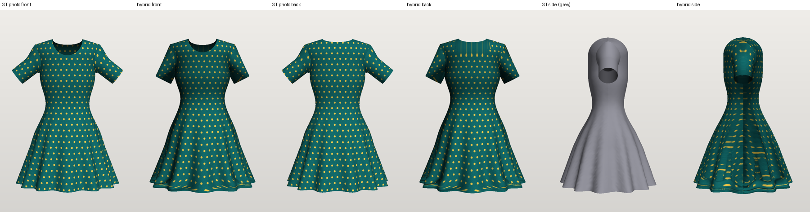
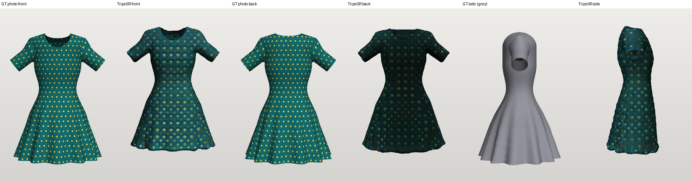

# Dress3D — Photo + Garment Measurements → Measured 3D Dress

**Technical report and handover (graduation-project prototype)** · last updated 2026-10-16

Evidence labels used throughout:
**[EXP]** verified by experiment in this repository · **[DOC]** verified from official documentation ·
**[EST]** estimate/assumption · **[NT]** not tested · **[BLK]** blocked.

> **Read this first.** All quantitative accuracy results come from **synthetic** test images rendered from dresses
> whose exact geometry is known. **No real garment with tape-measured dimensions has been tested.** Real-photo
> reconstruction was tried qualitatively on 2 public-domain (CC0) museum photos and 1 private user photo. All three
> showed visible distortions (§12). The prototype is a **research prototype, not production-ready**, and it does **not**
> produce accurate 3D models from arbitrary photographs.

---

## 1. Title and executive summary

**Dress3D** turns a dress photograph plus the garment's own measurements into an independent, rotatable 3D dress model
(GLB) shown in a web viewer. The dress is not worn by an avatar; fitting is a later phase. After generation, the system
re-measures the exported mesh and reports the error for every dimension.

Main outcomes:

| Finding | Evidence |
|---|---|
| The **hybrid approach** (photo cues + measurement-driven pattern-panel construction) was the best of those tested. It is the only one that gives a real garment surface (single layer with neck, hem and armhole/cuff openings) **and** reproduces the entered dimensions. | [EXP] §10 |
| Entered girths and lengths are reproduced within **≤ 0.43 %** when re-measured from the GLB, provided the heights where girths were measured are also given. Without `hip_position`, hip error reached **+4.9 %**. | [EXP] §10.3 |
| On the 4 synthetic cases: silhouette IoU 0.91–0.996 (front, side, back); mean surface distance 0.36–0.95 cm; silhouette, sleeve and neckline type classified correctly 4/4. | [EXP] §10.3 |
| Generic AI image-to-3D (**TripoSR**, MIT) runs on a CPU laptop but gives a sealed solid with no garment openings. Girth error was −10 % to +37 % even after best-case scaling. Unusable for dimensions or simulation. | [EXP] §10.4 |
| **GarmentCode** (MIT) produces real 2D sewing patterns on Windows. Its 3D draping simulator is licensed for non-commercial use only and needs CUDA. | [EXP]/[DOC] §10.5 |
| **Real photos are the weak link.** Mannequins, stands, three-quarter views, collars, and photos whose silhouette disagrees with the entered measurements all caused visible distortions. | [EXP] §12 |

---

## 2. Problem statement and objectives

Input: a real dress photo (front, optional back) plus manually entered garment measurements.
Output: an independently viewable 3D dress that can be rotated and zoomed.

Objectives:
1. Respect the **physical dimensions**, and verify them on the generated mesh.
2. Resemble the photographed dress.
3. Produce geometry suitable for later simulation and fitting.
4. Use only free, local, legally usable tools on an ordinary Windows laptop (no NVIDIA GPU, 7.7 GB RAM).

## 3. Scope and boundaries

**In scope:**
- Women's dresses in 3 silhouettes (straight, A-line, fit-and-flare).
- Sleeves: none, short or long.
- Necklines: round, V, square or boat.
- Measurement schema, photo analysis, GLB export, verification, web viewer.

**Out of scope / not implemented:**
- Avatars or virtual fitting, and body-to-garment fit.
- Collars, darts, pleats, gathers, ruffles, straps, wrap or asymmetric designs, pockets, layered skirts.
- Cloth simulation and draping.
- Fabric physical parameters.
- Multi-garment outfits.
- Accounts, a database, or cloud deployment.

## 4. Architecture and technology stack

```
Browser (React 18 + TypeScript + Three.js r169, built with Vite 5)
   │  JSON over HTTP (images as base64 data URLs)            127.0.0.1:8765 only
   ▼
prototype/server.py  (Python 3.12 stdlib ThreadingHTTPServer)
   ├─ dress3d.hybrid.reconstruct()   photo present → photo analysis + generation + texture projection
   │     └─ dress3d.photo            OpenCV GrabCut segmentation, width profile, style/position cues
   ├─ dress3d.schema.parse_spec()    measurements only → validation, units, defaults
   ├─ dress3d.generator              measurement-driven pattern-panel mesh (front/back panels + sleeves)
   ├─ dress3d.export                 GLB (metres) + landmarks JSON + approximate pattern SVG
   └─ dress3d.measure                independent re-measurement of the exported GLB → verification table
```

Python libraries: NumPy, SciPy, Shapely, trimesh, OpenCV (headless), Pillow, Matplotlib, NetworkX (pinned in
`requirements.txt`). The core pipeline has no machine-learning model and no GPU requirement.

## 5. Directory structure and important files

| Path | Purpose |
|---|---|
| `dress3d/schema.py` | Measurement schema (15 fields), unit conversion (cm/in), full vs laid-flat girths, defaults, validation |
| `dress3d/generator.py` | Core 3D construction: cross-sections, pattern panels, triangulation, seam welding, sleeves, landmarks |
| `dress3d/photo.py` | Photo analysis: segmentation, optional colour refinement (GMM), width profile, sleeve/neckline/silhouette/waist/armhole cues |
| `dress3d/hybrid.py` | Combines user measurements + photo cues → spec → mesh; front/back photo texture projection |
| `dress3d/measure.py` | Independent mesh measurement (plane sections, boundary loops, geodesic paths) |
| `dress3d/export.py` | GLB export (PBR material, double-sided), landmarks JSON, pattern SVG, synthetic print textures |
| `dress3d/render.py` | Small NumPy software rasterizer (synthetic reference images, evaluation, screenshots) |
| `prototype/server.py` | Local HTTP API + static file server for the built UI |
| `prototype/web/src/App.tsx` | UI: photo pickers, measurement form, style overrides, segmentation options, results table |
| `prototype/web/src/Viewer.tsx` | Three.js viewer: GLTFLoader, OrbitControls, view presets, wireframe, level markers |
| `prototype/web/src/api.ts` | Typed API client |
| `experiments/scripts/` | Experiment, evaluation and consolidation scripts (§10) |
| `experiments/inputs/synthetic/T1..T4` | Synthetic ground-truth dresses: `gt.glb`, `case.json`, reference "photos" |
| `experiments/inputs/real/R1, R2` | Two CC0 museum photos + `SOURCE.json` provenance |
| `results/measurements/*.csv, *.json` | Consolidated metrics (dimension errors, geometry metrics, mesh quality) |
| `results/screenshots/` | Comparison images and UI screenshots referenced in this report |
| `results/models/` | Representative hybrid and TripoSR GLBs for the synthetic cases |
| `results/*/metrics.json, summary.json` | Per-experiment raw metrics |
| `tests/test_core.py` | Unit/regression tests (stdlib `unittest`) |
| `tools/shims/` | Local stand-ins used only by the TripoSR experiment (`torchmcubes`, inert `rembg`) |
| `research/` | Approach comparison, sources, research log |

## 6. Detailed design

### 6.1 Frontend (`prototype/web`)
- **Photos:** front (recommended), back (optional), and an optional **garment mask** (white = dress), all read in the
  browser as data URLs. There are buttons to load the 4 synthetic test cases.
- **Measurement form:** 15 fields in 4 groups:
  - Core: dress length, bust, waist, hip, hem.
  - Girth positions: armhole depth, waist position, hip position.
  - Shoulders and neckline.
  - Sleeves.
- **Units:** cm or inches. Each girth can be marked "full girth" or "laid flat (×2)".
- **Style overrides:** silhouette, sleeve and neckline, each "auto" (from the photo) or forced.
- **Segmentation option:** "Remove non-fabric colours" (colour refinement).
- **Viewer:**
  - Rotate, zoom and pan; front/side/back/top presets; wireframe toggle.
  - Coloured rings mark the bust, waist and hip **heights**. They are markers only; their size does not show the girth.
  - A 10 cm floor grid.
- **Results panel:**
  - The method used.
  - Inferred style and the vertex/triangle count.
  - Warnings.
  - A verification table (value used vs. value measured on the mesh, error, and source: you / photo / default).
  - Links to download the GLB and the pattern SVG.
  - The segmentation mask.
- `?id=<12-hex id>` reopens a previous local result.

### 6.2 Backend (`prototype/server.py`)
- Stdlib `ThreadingHTTPServer` bound to **127.0.0.1** (port `DRESS3D_PORT`, default 8765). There is no authentication;
  it is meant for local use only.
- Uploaded images are decoded and downscaled to at most 900×1200 px. Request bodies over 40 MB are rejected.
- Each generation writes to `prototype/output/<id>/`: `dress.glb`, `dress.landmarks.json`, `pattern.svg`, `mask.png`
  (when a photo is used) and `report.json`.

### 6.3 Generation pipeline (`dress3d/generator.py`)
1. **Circumference profile C(d):** a monotone PCHIP spline over depth `d` below the high point shoulder (HPS). Its
   anchors are bust (at armhole + 2.5 cm), waist (`waist_position`), hip (`hip_position`) and hem. Extra anchors can
   come from the photo's width profile.
2. **Cross-section:** a superellipse whose depth/width ratio is 0.70 by default, rising toward 0.93 as the skirt flares.
   Optional skirt "folds" are cosine offsets. Each section is **rescaled numerically so its polygon perimeter equals
   C(d)**.
3. **Yoke and shoulders:** above the armhole, the depth is rounded to zero along the shoulder line, so the front and
   back meet at the shoulder seam.
4. **Pattern panels:**
   - Front and back outlines are drawn in (arc length *s*, depth *d*) space: neckline, shoulder, armhole, side seam, hem.
   - They are triangulated with conforming Delaunay (dense boundary, interior grid, clipping, sliver removal).
   - They are then wrapped onto the cross-sections.
   - Shared seam samples are welded.
5. **Sleeves:** tubes lofted from the real armhole loop to circles whose perimeters equal `upper_arm` (6 cm along the
   axis) and `cuff`. The sleeve angle comes from the photo (default 50°). The length is solved so the top line equals
   `sleeve_length`.
6. **Hem depth:** solved iteratively so the front surface path from HPS to hem equals `dress_length`.
7. **Two meshes are produced:**
   - A welded mesh for analysis and simulation.
   - An unwelded mesh with per-panel UVs for texturing and export.

   Faces are oriented outward (verified: 100 % outward on the front and back panels).

### 6.4 Measurement handling (`dress3d/schema.py`)
- Only `dress_length` and `bust` are required. Unknown fields, non-positive values, and inconsistent geometry are
  rejected with `ValueError`, which the API returns as HTTP 400. The geometry checks are: waist less than 4 cm below the
  armhole, and neck width not at least 4 cm narrower than shoulder width.
- Missing fields are filled, in priority order, from: **user → photo cue → documented default** (ratios to bust, by
  silhouette). Every value's source is reported.
- Field definitions and how each drives the geometry are listed in `README.md` ("Measurement schema").

### 6.5 Segmentation and photo cues (`dress3d/photo.py`)
- **Segmentation:**
  - Estimates the background from the image border, ignoring garment pixels that touch the frame.
  - Runs GrabCut.
  - Keeps the largest component and fills holes.
- **Colour refinement (optional):** fits a 4-component Gaussian mixture to colours from the central skirt region, then
  drops pixels that don't fit it, such as a white mannequin or the stand.
- **User mask:** overrides automatic segmentation entirely.
- **Cues:**
  - Sleeves: separated side runs in the mask.
  - Sleeve angle: a line fitted through the sleeve's run centres.
  - Neck width and back neck drop: from the top contour.
  - Front neck drop and neckline type: from the shaded neck opening (centre vs. adjacent fabric brightness).
  - Armhole depth: from where sleeves separate, or the width recovering below the armhole scoop.
  - Waist: the narrowest torso width.
  - Silhouette: the hem/bust width ratio.
- **Plausibility checks:** implausible cues are rejected and replaced by defaults, and the API warns about it.

### 6.6 Texture
- The front photo is projected onto the front panels and sleeves. The back photo, or the mirrored front photo if there
  is none, is projected onto the back.
- Projection is per row, normalised to the silhouette. Background pixels are replaced by the nearest garment colour
  first.
- Lighting stays baked into the texture, and texture stretches on the sides (§12).

### 6.7 Export and coordinates
- **GLB:** units are **metres**, y is up, the hem sits at y = 0, and +z is the front. It uses a PBR material
  (double-sided, roughness 0.92) with the base-colour texture.
- **`*.landmarks.json`:** in **cm**. Contains HPS, shoulder points, underarms, bust/waist/hip/hem heights, upper-arm
  planes and cuff centres.
- **`pattern.svg`:** approximate flattened front and back outlines in cm, without seam allowance. **Not sewable**
  (§11, strain).

### 6.8 Verification (`dress3d/measure.py`)
The GLB is reloaded, converted back to cm and re-welded, then measured without using generator parameters:
- **Girths:** closed plane-section loops around the vertical axis.
- **Hem and cuff:** boundary-loop edge lengths.
- **Neck:** extremes of the neck boundary loop.
- **Dress length:** a vertical section through the HPS.
- **Shoulder width and armhole depth (sleeveless):** extremes of the armhole loops.

Some measurements are **landmark-assisted**: for sleeved dresses the shoulder points and underarm come from the
sidecar JSON, snapped to the nearest mesh vertices, as do the sleeve-length end points and the upper-arm plane. The
waist **position** is found in 0.5 cm steps.

> The verification table shows *construction consistency*: the mesh matches the numbers it was given. It does
> **not** show that those numbers match a physical garment.

## 7. Installation, configuration and execution

Prerequisites:
- Windows 10/11 (also expected to work on Linux and macOS [EST, NT]).
- Python 3.12.
- Node.js 18+ (tested with 24.20) and npm.
- About 0.6 GB RAM per generation [EXP].
- No GPU.

```powershell
git clone https://github.com/baraahalameh2005-prog/clothes.git
cd clothes
python -m venv .venv
.venv\Scripts\python.exe -m pip install -r requirements.txt
cd prototype\web
npm ci                 # or: npm install
npm run build          # type-check (tsc) + production build into prototype/web/dist
cd ..\..
.venv\Scripts\python.exe prototype\server.py
# -> "Dress3D prototype on http://127.0.0.1:8765  (local only)"
```

Open http://127.0.0.1:8765. Configuration:
- `DRESS3D_PORT` environment variable sets the port.
- Dev mode: run `npm run dev` (Vite on 127.0.0.1:5173, proxies `/api` to the Python server).

Troubleshooting:

| Symptom | Cause / fix |
|---|---|
| `{"error": "not built - run npm run build in prototype/web"}` | `prototype/web/dist` is missing. It isn't in Git; run `npm run build`. |
| Port already in use | Another server instance is running; stop it or set `DRESS3D_PORT`. |
| Garment includes mannequin, hanger or stand | Enable "Remove non-fabric colours" or upload a mask (white = dress). |
| Warning "Implausible photo cues replaced by defaults" | Check the mask, or enter `armhole_depth`, `waist_position` and neckline values manually. |
| Server killed during long idle sessions | Seen once while the laptop was low on memory; just restart it. |

## 8. API (verified from `prototype/server.py`)

| Method | Path | Description |
|---|---|---|
| GET | `/api/schema` | `{measurements: {name: {kind, description}}, silhouettes, sleeves, necklines}` |
| GET | `/api/examples` | List of synthetic cases with suggested measurements |
| GET | `/api/examples/<case>/photo_front.png` \| `photo_back.png` | Synthetic reference images |
| POST | `/api/generate` | Generate a dress (below) |
| GET | `/api/out/<id>/dress.glb` \| `pattern.svg` \| `mask.png` \| `report.json` | Generated files (`model/gltf-binary` for GLB) |
| GET | any other path | Static file from `prototype/web/dist`, falling back to `index.html` |

`POST /api/generate` request (JSON):

```json
{ "front_image": "data:image/jpeg;base64,..." | null,
  "back_image":  "data:..." | null,
  "mask_image":  "data:..." | null,          // white = garment; overrides segmentation
  "colour_refine": false,
  "units": "cm" | "in",
  "measurements": { "dress_length": 95, "waist": {"value": 38, "method": "flat"}, ... },
  "style": { "silhouette": "auto|straight|a-line|fit-and-flare", "sleeve": "auto|none|short|long",
             "neckline": "auto|round|v|square|boat" },
  "options": { "fold_count": 8, "fold_amplitude": 1.5, "sleeve_angle_deg": 50, "depth_ratio": 0.7,
               "mesh_resolution_cm": 1.5 } }   // optional
```

Response (200): `id, method, glb_url, svg_url, mask_url, glb_bytes, vertices, faces, style, source,
measurements_cm, verification[{measurement, target_cm, measured_cm, abs_err_cm, pct_err, source, method}],
landmarks, warnings[], notes[], confidence{}`.

Errors:
- **400** `{"error": ...}` for invalid input, e.g. `'dress_length' is required` [EXP], or a mask with almost no white
  pixels.
- **413** if the body is over 40 MB.
- **404** for unknown paths.
- **500** `{"error": "<Type>: <message>"}` for unexpected failures.

Path handling: IDs must be alphanumeric, file names are whitelisted, and static paths are normalised and confined to
`dist`. Traversal attempts such as `/api/out/../../README.md` returned 404 [EXP].

## 9. Approaches evaluated

| ID | Approach | Status |
|---|---|---|
| A | Generic image-to-3D: **TripoSR** (MIT; 1.68 GB weights; CPU PyTorch) | **Tested** [EXP] |
| A | TRELLIS, Hunyuan3D-2, InstantMesh | **Blocked**: need a 6–16+ GB NVIDIA GPU or Linux [DOC]. Hunyuan3D-2's licence also excludes the EU, UK and South Korea. |
| A | Stable Fast 3D | **Excluded**: gated download (account required) [DOC] |
| B | Garment-specific learned (Sewformer, ChatGarment, Garment3DGen…) | **Not run**: no licence, paid Maya, GPT-4o, or GPU [DOC] |
| C | Pattern-based: **GarmentCode/pygarment** (MIT) | **2D patterns tested** [EXP]; 3D simulator **blocked** (NVIDIA non-commercial licence + CUDA) [DOC] |
| D | Own procedural generator | **Tested** [EXP] |
| E | Own hybrid (photo cues + D) | **Tested; recommended** [EXP] |

Details, licences and sources: `research/approach-comparison.md`, `research/sources.md`.

## 10. Experimental setup, results and interpretation

### 10.1 Test cases
`experiments/inputs/synthetic/` contains **4 synthetic** dresses:

| Case | Silhouette | Sleeves | Neckline | Print / folds |
|---|---|---|---|---|
| T1 | straight | sleeveless | round | stripes |
| T2 | A-line | sleeveless | V | dots, folds |
| T3 | fit-and-flare | short | round | folds |
| T4 | straight | long | square | stripes |

- Ground truth uses hidden settings the hybrid has to infer: depth ratio, folds, sleeve angle, and the waist, hip,
  armhole and neckline positions.
- Reference images come from the built-in renderer: perspective camera, 600×900 px, approximate interior shading.
- **These are not photographs.** They share the generator family with the hybrid, which favours the hybrid
  (see §10.6).

Real photos (`experiments/inputs/real/`):
- R1: Claire McCardell plaid day dress.
- R2: Rijksmuseum ivory gown.

Both are CC0, with **no published measurements**, so the measurements used were assumed and the evaluation is
qualitative only.

### 10.2 Metrics
- Dimension error (absolute and %) re-measured from the exported GLB.
- Silhouette IoU from 4 views with identical cameras.
- Chamfer distance in cm (mean and 95th percentile).
- Mean-colour ΔE (Lab).
- Topology: openings, components, non-manifold edges, winding.
- Triangle quality.
- Pattern-to-3D strain.
- Sleeve/torso interpenetration.
- Runtime and memory.

### 10.3 Hybrid results [EXP]
Data: `results/measurements/dimension_errors.csv`, `geometry_metrics.csv`, `mesh_quality.json`.

| Metric | Front photo + 6–9 measurements | Full measurement protocol |
|---|---|---|
| User-given girths/lengths | ≤ 0.43 % except **hip +1.8 % (T3), +4.9 % (T2)** when the hip *position* was not given | ≤ 0.43 % |
| Photo-inferred neck width / front neck drop | −0.5…−1.5 cm / −1.0…−2.1 cm | (given) |
| Photo-inferred armhole depth / waist position | −3.3…+1.7 cm / −3.3…+1.2 cm | (given) |
| Silhouette IoU front / side / back | 0.92–0.98 / 0.92–0.996 / 0.91–0.98 | 0.93–0.99 / 0.95–1.00 / 0.92–0.99 |
| Chamfer mean / 95th pct | 0.36–0.95 / 0.65–2.38 cm | 0.35–0.86 / 0.62–2.46 cm |
| Style classification | 4/4 silhouettes, sleeves and necklines | — |
| Runtime / peak memory | 3.5–9.6 s per case; one end-to-end run 12.8 s at ~630 MB peak | similar |

Adding the back photo didn't change the geometry. On these cases it barely changed back-colour accuracy, because the
synthetic front and back prints are identical. Its benefit on real dresses is **[NT]**.



### 10.4 TripoSR results [EXP]
- **Runtime:** 85–94 s per image on CPU (+18 s model load; the first run took 296 s including the download).
- **Memory:** about 4.5 GB private RAM, with heavy paging on 7.7 GB.
- **Alignment:** best-case scaling to the ground-truth height (plus an ICP variant).

| Metric | Value |
|---|---|
| Silhouette IoU front / side / back | 0.87–0.95 / 0.64–0.85 / 0.90–0.95 |
| Chamfer mean / 95th pct | 1.5–3.3 / 4.5–11.5 cm |
| Bust / waist / hip error | −10 % … +37 % (T1 +17 … +26 %) |
| Openings / components | 0 / 1–6 (sealed solid with floating fragments) |
| Mean-colour ΔE back | 19.8–41.6 (back hallucinated) |

Printed stripes and dots turned into geometric ridges and bumps, and flared skirts came out as flat slabs in depth.



### 10.5 GarmentCode [EXP]
- `pygarment` 2.0.2 installed and ran on Python 3.12/Windows. It generated a dress pattern (fitted bodice with darts +
  circle skirt) as SVG, PNG and JSON in `results/garmentcode/`.
- Its parameters are body-relative (e.g. `shirt.width` 1.0–1.3 × body), so garment measurements can't be entered
  directly.
- 3D requires its Warp-based simulator. That fork is NVIDIA Source Code License, **non-commercial only**, and needs a
  CUDA/MSVC build [DOC]. Not attempted.

### 10.6 Interpretation and threats to validity
- The hybrid's dimensional accuracy is **accuracy of construction**. Real-world accuracy also depends on how well the
  garment is measured, and on whether the real cross-section and drape match the model's assumptions. That is **[NT]**.
- The synthetic test is **favourable to the hybrid**: ground truth and reconstruction come from the same family of
  generators, though with different hidden settings. TripoSR had no such advantage.
- Detector thresholds were adjusted once after the first run. The v1 results are kept in `results/hybrid_front_v1/`.
- There are only 4 synthetic cases and 2 + 1 real photos, so there are no statistical claims.

## 11. Known limitations and current defects [EXP unless noted]
1. **Approximate pattern:** strain between the flattened pattern and the 3D panels is median 0.1–3.7 % but **10–41 %
   at the 95th percentile**, worst on flared skirts and the shoulder rounding. The SVG is not sewable.
2. **Sleeve/torso interpenetration** near the armhole: 7.5 % of sleeve vertices in T3, ≤ 0.7 % in T4.
3. **Folds are decorative** cosine waves, not draped cloth.
4. **The depth ratio is assumed.** It can't be seen in a front photo.
5. **Limited garment vocabulary** (§3). Collars, cuffs, buttons and plackets are present only as texture.
6. **Single-layer surface** with no thickness, lining or fabric parameters.
7. **No persistence or cleanup** of `prototype/output/`; it grows with every generation.

## 12. Photo-processing and segmentation limitations (real photos) [EXP, qualitative]

| Photo | Observed problems |
|---|---|
| R1 McCardell plaid (CC0, mannequin, three-quarter view) | Default segmentation failed: the invalid inferred waist made generation fail with an error. With colour refinement the mannequin was removed and a recognisable plaid dress was produced. However, the three-quarter view broke the frontal assumptions: sleeves sampled background colours, the side texture was streaked, and the armhole, waist and neck cues were rejected as implausible. `results/screenshots/real_photo__R1_mccardell_plaid__colour_refine.png` |
| R2 Rijksmuseum ivory gown (CC0, frontal, mannequin + stand) | Without refinement, the mannequin head, arms and stand were included: the neck point sat at the top of the head, mannequin skin was textured onto the bodice, and the stand was painted onto the hem. With refinement, the cream bodice and puff sleeves were removed as well, because the fabric is close to the mannequin's colour. Neither result is correct. `results/screenshots/real_photo__R2_rijksmuseum_blue__no_refine.png`, `…__colour_refine.png` |
| Private user photo (dark long-sleeve dress with white collar/cuffs and wide flared skirt; a back photo was apparently also supplied, inferred from the absence of the "no back photo" warning; all 15 measurements entered). Image **not published**. | Segmentation was clean. The measurements say hem 118 cm, which is narrow, while the photo shows a very wide flared skirt. The geometry follows the measurements, so the photo texture was **squeezed onto a narrower shape**. Grey smeared bands appeared along the sides and a dark smeared band at the hem. White collar and cuff pixels landed as patches on the shoulders and mid-sleeve: collars are unsupported and the sleeves were misregistered. The verification table still showed ≤ 0.15 % error, because it measures consistency with the inputs, not resemblance to the photo. |

General conclusions:
- Segmentation of real photos needs a user mask or a properly licensed garment-segmentation model.
- The front-view assumption means three-quarter views are not supported.
- The inferred cues are only as good as the mask.
- When the photo and the measurements disagree, nothing detects it. **No warning is raised.** This is a clear next
  improvement.

## 13. Geometry, topology, texture, sleeve, neckline and back-view limitations
- **Topology [EXP]:**
  - Hybrid meshes are 1 component, have 4 openings and 0 non-manifold edges, wind consistently, and have a 99th-percentile
    triangle aspect ratio of 5.9–8.2.
  - TripoSR meshes have 0 openings, 1–6 components, and slivers with a 99th-percentile aspect ratio of about 70.
- **Neckline [EXP]:**
  - Type was detected correctly on the synthetic set.
  - Front neck drop was underestimated by 1–2 cm.
  - Real photos rely on the neck opening looking shaded, which depends on lighting.
- **Sleeves:**
  - Angle is estimated from the photo.
  - The cap is a smooth blend, not a sewn sleeve cap.
  - Interpenetration as in §11.
  - Texture can sample background when the sleeve's angle or position in the photo doesn't match the model.
- **Back view:** without a back photo, the back is the mirrored front (the dark front-neck opening is suppressed).
  Not validated on real dresses.
- **Texture:** projection stretches on the sides, and lighting and shadows stay baked in.

## 14. Testing performed and gaps
| Check | Result |
|---|---|
| `python -m unittest discover -s tests -v` (5 tests: schema conversion/validation, sleeveless and long-sleeve round trip, hybrid on synthetic T2) | **OK, 5/5, 13.8 s** [EXP] |
| Smoke scripts `smoke_gen.py`, `check_normals.py` | Pass: 4 openings, consistent winding, 100 % outward normals [EXP] |
| `npm run build` (tsc type check + Vite build) | **Pass** [EXP] (Vite warns about a large three.js chunk) |
| Server start + `/api/schema`, `/`, `/api/examples`, invalid POST (400), procedural POST, traversal attempts | **Pass** [EXP] |
| Headless-browser UI screenshots with a loaded model | Pass [EXP], `results/screenshots/prototype_ui*.png` |

**Gaps:**
- No real garments with tape-measured ground truth.
- No real-photo accuracy metrics.
- No automated frontend or UI tests.
- No API tests in the suite (manual only).
- No tests on Linux/macOS.
- No load or concurrency tests.
- No TripoSR or GarmentCode tests in the suite (they need separate environments).

## 15. Licensing, provenance and redistribution
| Item | Licence / provenance | In repository? |
|---|---|---|
| Project source (`dress3d/`, `prototype/`, `experiments/`, `tests/`, docs) | Written for this project. **No licence file has been chosen yet**; the author should add one (e.g. MIT). Until then, default copyright applies. | Yes |
| Python dependencies | BSD/MIT/Apache-2.0 (OpenCV 5 Apache-2.0) | No (installed via pip) |
| npm dependencies | React, Three.js, Vite: MIT; TypeScript: Apache-2.0 | No (`package-lock.json` pins them) |
| Synthetic inputs and their renders/meshes | Generated by this project | Yes |
| R1, R2 photos (600–960 px thumbnails) | **CC0**, via Wikimedia Commons (Rijksmuseum for R2). Source URLs in `experiments/inputs/real/*/SOURCE.json` | Yes |
| TripoSR code and weights | MIT (Tripo AI & Stability AI). Weights 1.68 GB on Hugging Face (ungated) | **No**: clone/download as in `README.md` |
| TripoSR output meshes for the synthetic cases (`results/models/triposr_raw__*.glb`) | Derived from MIT model + own synthetic inputs | Yes (about 8 MB) |
| GarmentCode code | MIT. Its simulator fork is NVIDIA SCL (non-commercial). Bundled body models: some CC BY 4.0 (SMPL averages) per its README | **No**: clone as in `README.md` |
| GarmentCode pattern outputs (`results/garmentcode/`) | Derived from MIT code + the authors' "mean_all" body measurements | Yes (small) |
| `tools/shims/` | Written for this project | Yes |
| Private user photos and their generated GLBs (`prototype/output/`) | **Private** | **No** (`.gitignore`) |

## 16. Security, privacy and data handling
- **Local only.** The server binds to 127.0.0.1 and has no authentication. **Do not expose it on a network** without
  adding authentication, upload limits and rate limiting.
- **No external calls.** The server makes no outbound network calls and photos never leave the machine. The experiment
  scripts downloaded the TripoSR weights, the CC0 photos and packages; the app itself downloads nothing.
- **Generated GLBs embed the uploaded photo as their texture.** Treat `prototype/output/` as private data. It is
  git-ignored and never cleaned automatically.
- No secrets, tokens, `.env` files or credentials exist in the project (scanned before publication).

## 17. Current status
| Item | Status |
|---|---|
| Measurement schema, units, laid-flat girths, defaults, validation | **Completed** [EXP] |
| Procedural generator (3 silhouettes × 3 sleeve types × 4 necklines) | **Completed**, with known defects (§11) |
| Independent GLB re-measurement | **Completed** [EXP] |
| Hybrid photo pipeline on synthetic images | **Completed** [EXP] |
| Hybrid photo pipeline on real photos | **Partially working / unreliable** (§12) |
| Web prototype (upload, form, viewer, export, verification) | **Completed** as a local prototype [EXP] |
| TripoSR baseline | **Completed experiment; rejected** |
| GarmentCode | **2D completed; 3D blocked** |
| Real-garment validation | **Not attempted** |
| Cloth simulation / drape, true flat patterns | **Not attempted** |
| Avatar integration / fitting | **Out of scope; not attempted** |

## 18. Prioritised future improvements
1. **Real-garment validation set:**
   - 5–10 dresses.
   - Tape-measured full protocol, including the girth heights.
   - Front, back and side photos on a plain background.
   - Report mesh-vs-tape and silhouette-vs-photo errors.
2. **Photo/measurement consistency check:** warn when the photo's width ratios (hem/bust, waist/bust) disagree with
   the entered girths (§12, private photo).
3. **Segmentation:**
   - An interactive brush mask in the UI.
   - Evaluate permissively licensed garment-segmentation models (check the licences first).
4. **True patterns + drape:**
   - Proper panel flattening (LSCM/ARAP) and darts.
   - Drape with a permissively licensed simulator (own XPBD solver, or Blender as an external tool).
   - This fixes the decorative folds, the interpenetration and the pattern strain.
5. **Side photo** to estimate the cross-section depth ratio.
6. **Garment vocabulary:** collars, straps, pleats, gathers.
7. **Engineering:**
   - API tests.
   - Output cleanup.
   - A licence file.
   - Optional `.glb` size reduction.

## 19. Handover
See **`HANDOVER.md`** for the teammate's practical guide: what works, where things live, commands, how to reproduce,
what to fix first, and the integration contract to agree on.

## 20. Final checklist — run and verify the prototype
- [ ] `python --version` → 3.12.x; `node --version` → ≥ 18
- [ ] `.venv\Scripts\python.exe -m pip install -r requirements.txt` completes
- [ ] `.venv\Scripts\python.exe -m unittest discover -s tests -v` → `Ran 5 tests … OK`
- [ ] `cd prototype\web && npm ci && npm run build` → `✓ built in …`
- [ ] `.venv\Scripts\python.exe prototype\server.py` → `Dress3D prototype on http://127.0.0.1:8765  (local only)`
- [ ] Open http://127.0.0.1:8765, click **T2 aline vneck**, press **Generate** → an A-line V-neck dress appears; the
      verification table shows ≤ 0.5 % on user-given values, and the hip row stays near 0 % because `hip_position` is
      supplied by the example.
- [ ] Rotate, zoom, and use the front/side/back/top buttons; **Download GLB** opens in any glTF viewer.
- [ ] Measurement-only mode: remove the photo, enter `dress_length` and `bust` only → a plain dress with "default"
      tags.
