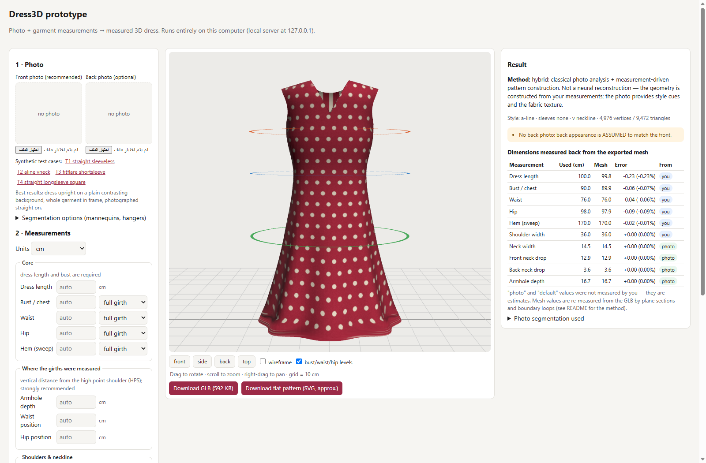

# Dress3D — photo + garment measurements → measured 3D dress (research prototype)

Turns a dress photo (front, optional back) plus the garment's real measurements into an independent, rotatable 3D
dress (GLB). The exported mesh is then **re-measured** to verify every dimension.

* **Approach:** measurement-driven pattern-panel construction (geometry). Classical computer vision supplies style cues
  and texture from the photo. It is **not** a neural 3D reconstruction.
* **Status:** research prototype.
  * Accuracy has been demonstrated only on **synthetic** test images.
  * Real photos (mannequins, three-quarter views, collars, photo/measurement mismatch) show visible distortions.
  * No real garment with tape-measured dimensions has been validated yet.

📄 **Full technical report:** [`FINAL_REPORT.md`](FINAL_REPORT.md) · 🤝 **Teammate guide:** [`HANDOVER.md`](HANDOVER.md) ·
🔬 [`research/approach-comparison.md`](research/approach-comparison.md) · 📚 [`research/sources.md`](research/sources.md)



## Prerequisites
- Python 3.12.
- Node.js ≥ 18 with npm.
- Windows 10/11 (tested). Linux/macOS untested.
- No GPU, no accounts, no API keys. About 0.6 GB RAM per generation.

## Install and run
```powershell
git clone https://github.com/baraahalameh2005-prog/clothes.git
cd clothes
python -m venv .venv
.venv\Scripts\python.exe -m pip install -r requirements.txt

cd prototype\web
npm ci
npm run build                 # type-check + build the UI into prototype/web/dist (not committed)
cd ..\..

.venv\Scripts\python.exe prototype\server.py
# Dress3D prototype on http://127.0.0.1:8765  (local only)
```
Open http://127.0.0.1:8765 and follow these steps:
1. Choose a front photo, or click one of the **synthetic test cases**.
2. Enter the measurements: cm or inches, full girth or laid flat (×2).
3. Optionally override the style.
4. Press **Generate**.

Then rotate, zoom, pan and switch views, and download the **GLB** and the **approximate** pattern SVG. The result panel
shows each dimension as re-measured from the mesh, tagged **you / photo / default**.

Settings:
- Port: `DRESS3D_PORT` (default 8765).
- UI hot-reload dev mode: run the server, then `npm run dev` in `prototype/web`.

### Real photos with mannequins or hangers
Open **Segmentation options**. Either enable *Remove non-fabric colours*, or upload a mask image (white = dress,
black = everything else). Also measure the girth **positions** (`armhole_depth`, `waist_position`, `hip_position`):
without them the girth heights are ambiguous, and hip error reached +4.9 % in tests.

## Tests
```powershell
.venv\Scripts\python.exe -m unittest discover -s tests -v     # expect: Ran 5 tests ... OK
cd prototype\web; npm run build                                # expect: ✓ built
```

## Measurement schema (summary)
Required: `dress_length`, `bust`. Optional: `waist`, `hip`, `hem`, `shoulder_width`, `neck_width`,
`front_neck_drop`, `back_neck_drop`, `armhole_depth`, `waist_position`, `hip_position`, `sleeve_length`,
`upper_arm`, `cuff`.

- Lengths are measured from the **HPS** (high point shoulder, at the neck seam).
- Girths are full circumference unless marked `"method": "flat"`.
- The GLB is in **metres**: y up, hem at y = 0, +z = front. Reports and landmarks are in cm.

Definitions and how each field drives the geometry: `FINAL_REPORT.md` §6 and `dress3d/schema.py`.

## Repository layout
```
dress3d/          core library: schema, generator, photo, hybrid, measure, export, render
prototype/        server.py (local API) + web/ (React + TypeScript + Three.js, Vite)
tests/            unittest suite
experiments/      scripts/ and inputs/ (synthetic ground truth + 2 CC0 photos)
results/          metrics (measurements/), screenshots/, models/, per-experiment metrics
research/         approach comparison, sources, research log
tools/shims/      local stand-ins used only by the TripoSR experiment
```

## Reproducing the experiments (optional)
The core experiments use only `.venv`:
```powershell
.venv\Scripts\python.exe experiments\scripts\make_testcases.py     # regenerates synthetic inputs (deterministic)
.venv\Scripts\python.exe experiments\scripts\run_hybrid.py         # also: --back, --full
.venv\Scripts\python.exe experiments\scripts\run_real.py
.venv\Scripts\python.exe experiments\scripts\mesh_quality.py
.venv\Scripts\python.exe experiments\scripts\consolidate.py
```
Baselines need separate environments and third-party code that is **not** included in this repository:
- **TripoSR:**
  - `git clone https://github.com/VAST-AI-Research/TripoSR tools/TripoSR` (commit `107cefd`).
  - Create `.venv-triposr`, then `pip install torch --index-url https://download.pytorch.org/whl/cpu` and
    `-r requirements-triposr.txt`.
  - Run `experiments\scripts\run_triposr.py`, which downloads the 1.68 GB MIT weights into `cache/hf`, then
    `eval_triposr.py`.
  - About 90 s per image on CPU and about 4.5 GB RAM.
- **GarmentCode:**
  - `git clone --depth 1 https://github.com/maria-korosteleva/GarmentCode tools/GarmentCode` (commit `d449629`).
  - Create `.venv-garmentcode` and install `-r requirements-garmentcode.txt`.
  - Run `experiments\scripts\run_garmentcode.py`.

## Known limitations (see the report for evidence)
- Only 3 silhouettes × {no, short, long} sleeves × {round, V, square, boat} necklines. No collars, darts, pleats,
  gathers or straps.
- Real-photo segmentation is unreliable (mannequins, stands, similar colours). Three-quarter views are unsupported.
- No warning when the photo silhouette contradicts the measurements; the texture is then squeezed or stretched.
- Folds are decorative, not draped. Sleeves slightly penetrate the torso near the armhole. The pattern SVG is
  approximate (not sewable).
- The texture is a front/back projection: sides are stretched and lighting is baked in.
- The local server has no authentication. Don't expose it on a network. Generated GLBs embed uploaded photos;
  `prototype/output/` is git-ignored.

## Licence
No licence has been chosen yet for the project code; the authors should add one. Third-party licences and asset
provenance (CC0 photos, MIT TripoSR, MIT GarmentCode) are listed in `FINAL_REPORT.md` §15.
